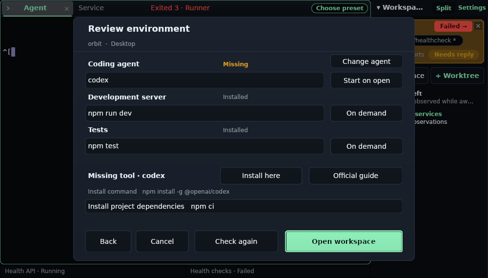
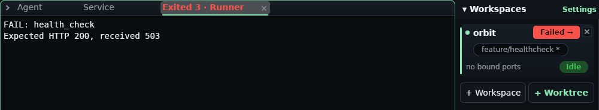

# Daedalus

Daedalus is a native workbench for running a coding agent, a development service, and tests side by
side. Each Git worktree has its own panes, ports, and Compose project. A persistent daemon owns the
processes, so you can close the window and reconnect later.


## Install

Download the installer for your machine from
[GitHub Releases](https://github.com/AraneaDev/daedalus/releases/latest). Native installers start
with the 0.0.7 series. Earlier releases provide portable archives.

| Platform | Asset | Installation |
| --- | --- | --- |
| Ubuntu 24.04 or compatible Debian-based Linux, x86-64 | `.deb` | Run `sudo apt install ./daedalus-<version>-amd64.deb`. Launch **Daedalus** from the applications menu. |
| Arch Linux, x86-64 (v0.0.10 onward) | `.pkg.tar.zst` | Run `sudo pacman -U ./daedalus-<version>-1-x86_64.pkg.tar.zst`. Launch **Daedalus** from the applications menu. |
| macOS, Apple Silicon or Intel (Intel packages start with v0.0.11) | `*-arm64.pkg` or `*-x86_64.pkg` | Open the package, follow Installer, then open **Daedalus** from Applications. CLI tools are linked in `/usr/local/bin`. |
| Windows, x64 | `.msi` | Open the setup wizard, choose **Install**, then launch **Daedalus** from Start. Open a new terminal to use the CLI. |

Packages include the UI, daemon and control CLI. The macOS and Windows installers are unsigned. Each
asset has a sibling SHA-256 checksum. Compare the downloaded file with its checksum using
`sha256sum` on Linux, `shasum -a 256` on macOS, or `Get-FileHash` in PowerShell.

## First workspace

Launch **Daedalus** to set up your first workspace. Choose a project folder on the daemon host and
select **Review environment**. Daedalus reads the repository configuration and suggests commands
for the coding agent, development server, and tests. Review the commands and choose **Open
workspace**. Only the agent starts by default. Use **Run tests** when you are ready.



The review shows which executables the daemon can find. **Install here** shows the installer
command and runs it in a setup terminal on that host. When it exits, the review checks again
without discarding your command edits. For supported tools you can also open the official
installation guide and select **Check again**. A locked npm project without installed dependencies
offers a separate `npm ci` action.

You can skip setup and reopen it from **+ Workspace**. To use the existing direct-start flow from
a terminal in a repository, run:

```sh
daedalus-ui --dir . --agent shell
```

The UI starts the local daemon and opens the agent terminal. Select a named tab to switch terminals.
Use `Ctrl+Shift+Z` for a split view. Use the shell preset to try the workbench
immediately. To use Claude, Codex or agy, install the corresponding CLI and choose its preset with
the agent picker. Press `Shift+Enter` in the picker to start an additional agent in this workspace.
Docker and Compose are needed only for container workflows.

Choose **+ Workspace** to enter a name and a project folder on the daemon host. If the daemon
refuses the folder, the form keeps your entries and selects the folder for correction.
The sidebar groups linked worktrees under their repository and lists tools detected in each
workspace root. It recognizes Compose, Cargo, npm, Composer, Python, and Make. Opening a mixed
project shows each tool and preserves the commands you set in `.daedalus.toml`.
In **Settings**, add any number of named agents or commands. For example, add a Codex agent named
“Reviewer” and a runner named “Unit tests”. For the runner, enter `cargo` as the executable
and `test` as its first argument. Each argument has its own field, so a value containing spaces
stays a single argument.
**Save** records the assignments in your local Daedalus configuration. **Save & launch** also opens
the selected assignment in its own terminal. Switching workspaces restores your selected terminal.


**Since you left** shows observed agent activity, command exits and changes in service status.
Select a pane event to open the terminal that produced it while that terminal is available.
With the keyboard, press `Ctrl+Shift+Y`, choose an event with Up or Down, and press Enter.
When you reopen the UI, the daemon can replay recent activity for each workspace. A gap is shown
if the daemon restarted or older events expired.

A worktree card shows **Failed →** when one of its runner terminals has failed. Select it to
open that terminal directly, even from another worktree. Press **Ctrl+Shift+R** to visit
failing workspaces in sidebar order.



## Keybindings (`daedalus-ui`)

| Shortcut | Action |
|----------|--------|
| `Alt+1` / `Alt+2` / `Alt+3` | Focus the agent, service or runner terminal. Repeat to cycle through terminals of the same role. |
| `Ctrl+Shift+H/J/K/L` | Directional focus across panes |
| `Ctrl+Shift+Z` | Toggle pane zoom |
| `Ctrl+Shift+B` | Toggle workspace sidebar |
| `Ctrl+Tab` / `Ctrl+Shift+Tab` | Switch to the next / previous workspace |
| `Ctrl+Shift+S` | Edit workspace assignments |
| `Ctrl+Shift+P` | Open/close Agent preset picker (`agy`, `claude`, `codex`, `shell`) |
| `Ctrl+Shift+X` | Close the focused terminal and stop its process. You can also click × on the selected terminal tab. |
| `Ctrl+Shift+W` | Open/close New Git Worktree modal |
| `Ctrl+Shift+A` | Open workspace action palette |
| `Ctrl+Shift+N` | Open the new workspace form |
| `Ctrl+Shift+T` | Launch the saved setup test command in the current workspace. |
| `Ctrl+Shift+R` | Open a failed runner. Repeat to visit the next failing workspace. |
| `Ctrl+Shift+E` | Forward latest `Runner` failure trace to `Agent` (bracketed paste) |
| `Ctrl+Shift+C` / `V` | Copy selection / Bracketed-paste clipboard |
| `Ctrl+Shift+F` | Search the focused pane. Enter advances, Shift+Enter goes back, and Esc closes search. The search bar also has previous and next controls and a match-case toggle (F4). |
| `Shift+PageUp` / `PageDown` / `End` | Scrollback navigation |

---

Click **Workspaces** to show or hide the sidebar at any window width. In narrow windows, the panes
stack vertically. For long workspace lists, scroll over the sidebar or use its page arrows.

On macOS, use Cmd for the workbench shortcuts shown with Ctrl+Shift.

Use the **+ Worktree** button to open a branch in its own workspace. If you request Compose
teardown when closing it and Docker fails, Daedalus stops the panes and keeps the workspace and
checkout so you can retry.


Screen readers can select or close individual terminal tabs, edit workspace assignments, and
read connection status, dialog feedback and search context.
In **New Git Worktree**, type the branch name and activate **Create**
or **Cancel** with the pointer, keyboard, or an assistive tool. Create becomes available when a
branch name is present and the daemon is connected.

## CLI & External Status Hook (`daedalus-ctl` / `events.sock`)

```bash
# Check daemon status
daedalus-ctl ping

# Discover or create an isolated git worktree workspace
daedalus-ctl worktree list --dir .
daedalus-ctl worktree create feat/billing --dir .

# Publish an external status badge via CLI
daedalus-ctl status publish --source phrourion --dir . --level warn --label "3 dirty"

# Or pipe 1-line NDJSON directly to $XDG_RUNTIME_DIR/daedalus/events.sock
printf '{"source":"cassandra","root_dir":"%s","level":"error","label":"retry 3/5"}\n' "$PWD" \
  | socat - UNIX-CONNECT:"${XDG_RUNTIME_DIR}/daedalus/events.sock"
```

---

## Sidebar status widgets

Register a provider and choose its sidebar rows in the workspace root's `.daedalus.toml`.
For example, this CI provider shows build and test results independently.

```toml
[[status_providers]]
id = "ci"
statuses = ["build", "test"]

[[sidebar_widgets]]
title = "Checks"
provider = "ci"
statuses = ["build", "test"]
```

Publish to a row using the provider ID and status key joined by a dot. Clearing a result returns
that row to **No report**. A plain external badge can still be published without a declaration.

```sh
daedalus-ctl status publish --source ci.build --dir . --level ok --label "Passed"
daedalus-ctl status publish --source ci.test --dir . --level error --label "2 failed"
daedalus-ctl status clear ci.test --dir .
```

## Remote workspaces and custom actions

Start `daedalusd` on the remote host, then pass its Unix socket path to either client. The example
assumes the SSH alias `devbox` and remote UID 1000. OpenSSH must be installed on the client and
socket forwarding enabled on the server.

```sh
daedalus-ui --socket ssh://devbox/run/user/1000/daedalus/daedalusd.sock
daedalus-ctl --socket ssh://devbox/run/user/1000/daedalus/daedalusd.sock ping
```

To require a bearer token, set `DAEDALUS_AUTH_TOKEN` in the daemon environment and supply the same
value in the client environment.

Define actions in the workspace root's `.daedalus.toml`. For example, this action submits the
workspace test command to the runner pane.

```toml
[[actions]]
id = "test"
label = "Run workspace tests"
target = "runner"
command = "cargo test --workspace"
```

Open the action palette with **Ctrl+Shift+A** (**Cmd+Shift+A** on macOS), select an action, and
press Enter. From the CLI, use `daedalus-ctl action list --workspace <uuid>` or
`daedalus-ctl action run test --workspace <uuid>`. When connecting remotely, use the workspace UUID
reported by the remote daemon.

## Build from source

Use stable Rust with the 2024 edition. On Ubuntu, install
`pkg-config libxkbcommon-dev libwayland-dev libxcb1-dev libxcb-render0-dev libxcb-shape0-dev libxcb-xfixes0-dev`.
macOS builds use the Xcode command-line tools. Windows builds use the MSVC Rust toolchain and Visual
Studio C++ build tools.

```sh
cargo build --release --workspace --locked
```

Run the binaries from `target/release`. The default terminal backend is implemented in Rust.
To build the daemon with the native Ghostty terminal engine, install libghostty-vt from revision
`df28358dd4a228749a237ed031de2f8dde163d99`. Set `GHOSTTY_VT_DIR` to the installation prefix
or make `libghostty-vt.pc` available to pkg-config. Run
`cargo build --release --locked -p daedalusd --features ghostty-vt` and ensure the system loader
can find the shared library when starting the daemon. The native CI workflow builds the pinned
library and exercises both backends with terminal transcripts.

## Development

Regenerate the README screenshots on Linux with `scripts/screenshots.sh`. It uses Xvfb, xauth,
xdotool, ImageMagick, Python 3, Git, and a working Mesa software renderer to capture a disposable
example project on a private display.

CI checks the default Rust backend on Linux, macOS and Windows. From a checkout, run:

```sh
git config core.hooksPath .githooks
cargo fmt --all -- --check
cargo clippy --workspace --all-targets --locked -- -D warnings
cargo test --workspace --locked
RUSTDOCFLAGS="-D warnings" cargo doc --workspace --locked --no-deps
cargo build --workspace --locked
```

Linux CI also checks Markdown structure and local links, Python lint and formatting, packaging
scripts, workflow definitions and the RustSec advisory database. To run the same checks, install
ShellCheck, then run:

```sh
python3 -m venv /tmp/daedalus-quality
. /tmp/daedalus-quality/bin/activate
pip install -r scripts/quality-tools.txt
scripts/check-sources.sh
cargo install cargo-audit --version 0.23.0 --locked
python3 scripts/check_audit.py
```

The audit fails on vulnerabilities, yanked dependencies and new advisory warnings. Five transitive
warnings from font rendering and Linux accessibility are printed on every run. Their exact versions
and advisory IDs are recorded in `scripts/check_audit.py` and need review at each version change.

To measure workspace coverage and test whether the suite detects changes to frame encoding,
decoding and terminal erasure, run:

```sh
rustup component add llvm-tools-preview
cargo install cargo-llvm-cov --version 0.9.0 --locked
cargo install cargo-mutants --version 27.1.0 --locked
scripts/check-test-quality.sh
```

The workspace coverage floors are 92.9% for lines, 92.5% for functions, and 92.4% for regions.
On Linux the gate
also runs a native desktop test in Xvfb with Xauth, Mesa Vulkan, and the system Python Xlib package.
Set `DAEDALUS_TEST_PYTHON` to use a different Python interpreter with Xlib installed. The
mutation gate fails on surviving or timed-out mutations. Mutation results are written under
`target/quality/`. Native Ghostty checks require the external Ghostty C library and headers.

The [specification follow-up](docs/spec-follow-up.md) records the remaining implementation work and
its acceptance tests.

## License

MIT
