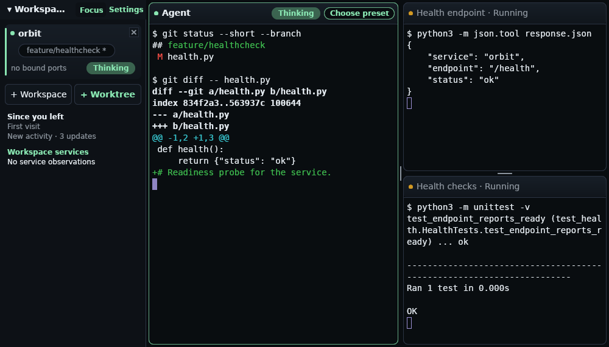
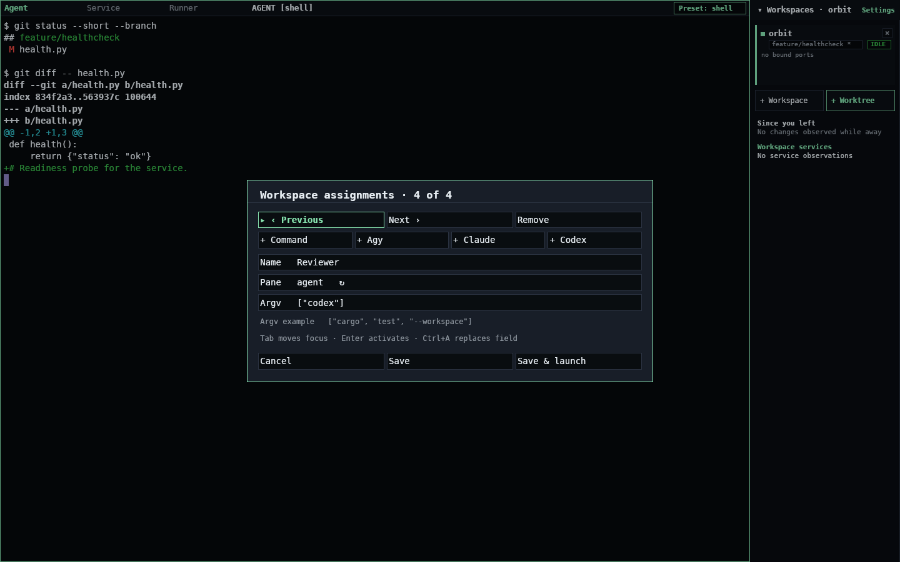
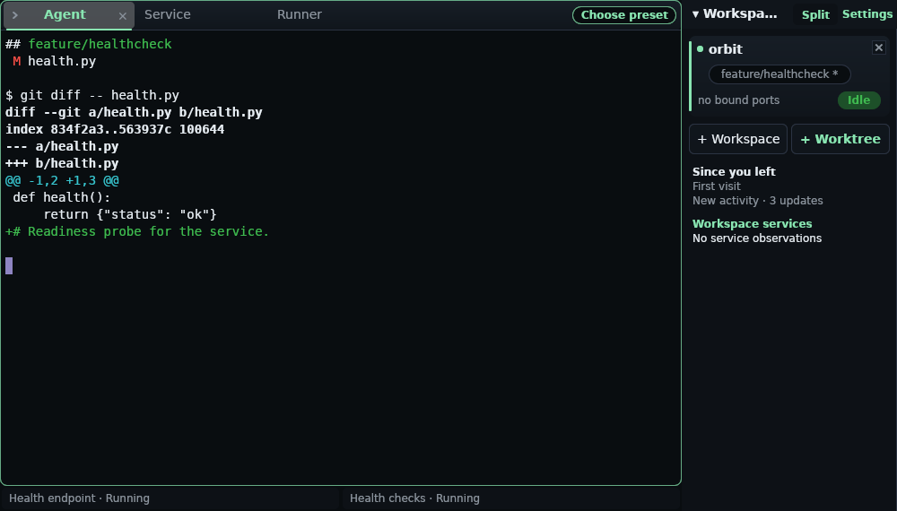
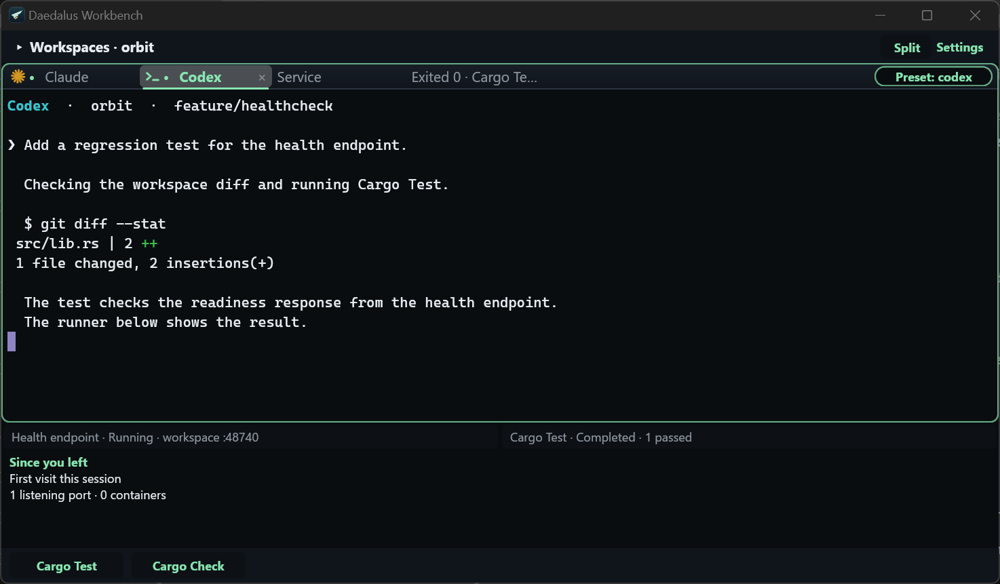
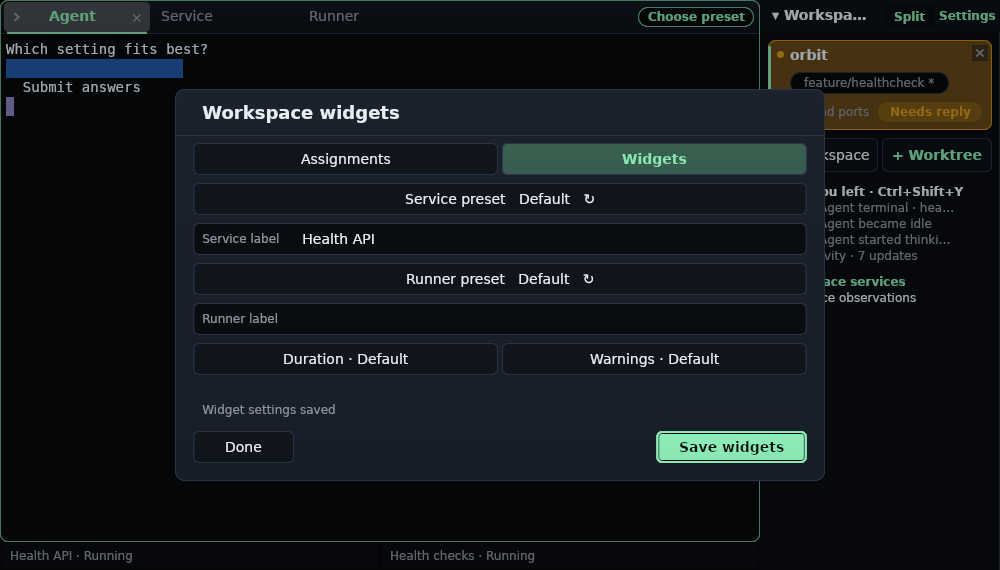
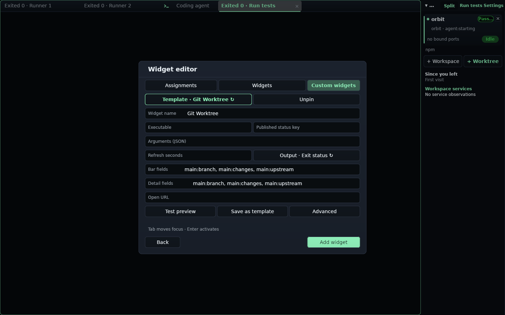
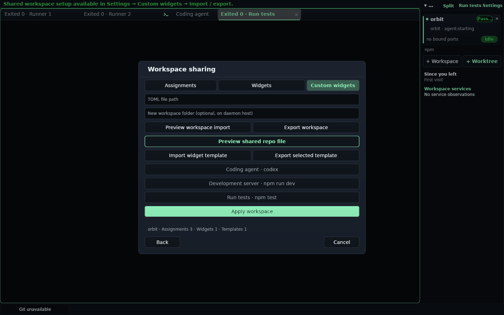
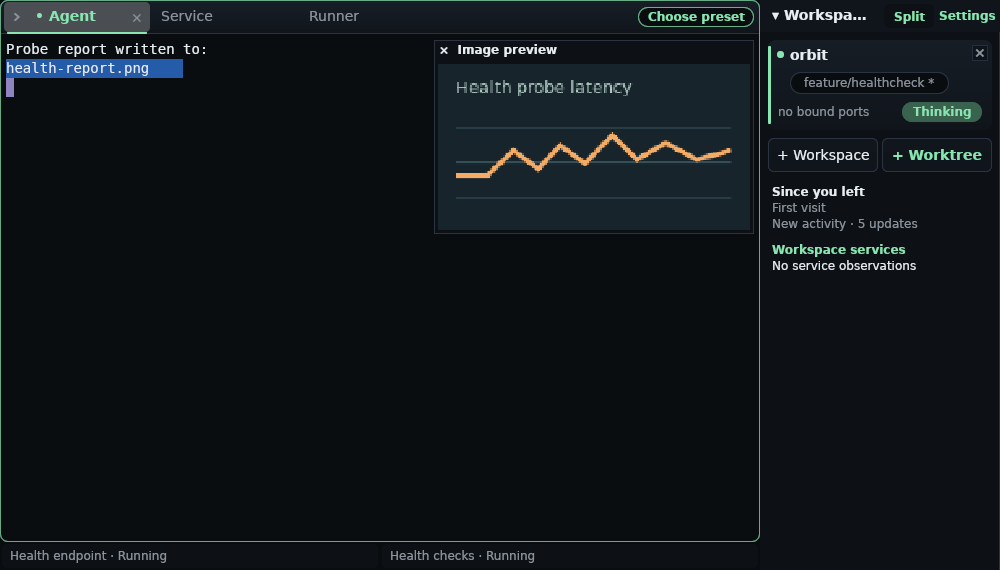
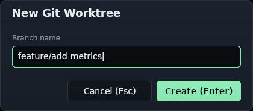

# Daedalus

Daedalus is a native workbench for running a coding agent, a development service, and tests side by
side. Each Git worktree has its own panes, ports, and Compose project. A persistent daemon owns the
processes, so you can close the window and reconnect later.



## Install

Download the installer for your machine from
[GitHub Releases](https://github.com/AraneaDev/daedalus/releases/latest). Native installers start
with the 0.0.7 series. Earlier releases provide portable archives.

| Platform | Asset | Installation |
| --- | --- | --- |
| Ubuntu 24.04 or compatible Debian-based Linux, x86-64 | `.deb` | Run `sudo apt install ./daedalus-<version>-amd64.deb`. Launch **Daedalus** from the applications menu. |
| Arch Linux, x86-64 (v0.0.10 onward) | `.pkg.tar.zst` | Run `sudo pacman -U ./daedalus-<version>-1-x86_64.pkg.tar.zst`. Launch **Daedalus** from the applications menu. |
| macOS, Apple Silicon or Intel (Intel packages start with v0.0.11) | `*-arm64.pkg` or `*-x86_64.pkg` | Open the package, follow Installer, then open **Daedalus** from Applications. CLI tools are linked in `/usr/local/bin`. |
| Windows, x64 | `.msi` | Open the setup wizard, choose **Install**, then launch **Daedalus** from Start. Open a new terminal to use the CLI. |

Packages include the UI, daemon and control CLI. The macOS and Windows installers are unsigned. Each
asset has a sibling SHA-256 checksum. Compare the downloaded file with its checksum using
`sha256sum` on Linux, `shasum -a 256` on macOS, or `Get-FileHash` in PowerShell.

## First workspace

Launch **Daedalus** to set up your first workspace. Choose a project folder on the daemon host and
select **Review environment**. Daedalus reads the repository configuration and suggests commands
for the coding agent, development server, and tests. Review the commands and choose **Open
workspace**. Only the agent starts by default. Use **Run tests** when you are ready.


The review shows which executables the daemon can find. **Install here** shows the installer
command and runs it in a setup terminal on that host. When it exits, the review checks again
without discarding your command edits. For supported tools you can also open the official
installation guide and select **Check again**. A locked npm project without installed dependencies
offers a separate `npm ci` action.

You can skip setup and reopen it from **+ Workspace**. The start screen lists your recent projects
above the form for a new one. Choosing a project that already has a saved setup opens its workspace
and starts only its agent. A project without one goes through the environment review. To use the
existing direct-start flow from a terminal in a repository, run:

```sh
daedalus-ui --dir . --agent shell
```

The UI starts the local daemon and opens the agent terminal. Select a named tab to switch terminals.
Choose **Split** or press `Ctrl+Shift+Z`, then drag the dividers to resize the panes.
Use the shell preset to try the workbench immediately. To use Claude, Codex or agy, install the
corresponding CLI and choose its preset with the agent picker.
Press `Shift+Enter` in the picker to start an
additional agent in this workspace. Docker and Compose are needed only for container workflows.

Choose **+ Workspace** to enter a name and a project folder on the daemon host. If the daemon
refuses the folder, the form keeps your entries and selects the folder for correction.
The sidebar groups linked worktrees under their repository and lists tools detected in each
workspace root. It recognizes Compose, Cargo, npm, Composer, Python, and Make. Opening a mixed
project shows each tool and preserves the commands you set in `.daedalus.toml`.
In **Settings**, add any number of named agents or commands. For example, add a Codex agent named
“Reviewer” and a runner named “Unit tests”. For the runner, enter `cargo` as the executable
and `test` as its first argument. Each argument has its own field, so a value containing spaces
stays a single argument.
**Save** records the assignments on the daemon so its clients share them. With an older daemon
that lacks project setup support, Daedalus saves them in the client's local configuration.
**Save & launch** also opens the selected assignment in its own terminal. Switching workspaces
restores your selected terminal.



**Since you left** shows observed agent activity, command exits and changes in service status.
Select a pane event to open the terminal that produced it while that terminal is available.
With the keyboard, press `Ctrl+Shift+Y`, choose an event with Up or Down, and press Enter.
When you reopen the UI, the daemon can replay recent activity for each workspace. A gap is shown
if the daemon restarted or older events expired.

A worktree card shows **Failed →** when one of its runner terminals has failed. Select it to
open that terminal directly, even from another worktree. Press **Ctrl+Shift+R** to visit
failing workspaces in sidebar order.


## Compact workbench widgets

The focused agent view shows service and runner summaries below the terminal. Select a summary to
open its terminal. When Cargo reports a diagnostic, **View failure** reveals it in place and keeps
the agent selected. In split view the same information appears in the pane header. Recognized Codex
and Claude sessions have distinct tab marks alongside their session names.



In Cargo workspaces, choose **Cargo Test** or **Cargo Check** in the bottom bar to run the preset
on the workspace host while keeping your agent in view. In workspace **Settings**, use
**+ Cargo Test** or **+ Cargo Check** to save an editable runner command.
To hide either automatic shortcut for this workspace, open **Settings → Widgets**,
choose **Hide Cargo Test** or **Hide Cargo Check**, then select **Save widgets**.



Configure project widget defaults in the daemon checkout’s `.daedalus.toml`. For example:

```toml
[runner]
command = ["cargo", "test", "--workspace"]

[runner.widget]
preset = "cargo-test"
label = "Workspace tests"
show_duration = true
show_warnings = false

[service.widget]
preset = "service"
label = "Development server"
```

Use `cargo-check` for compiler progress and warnings, or `command` for generic command status.
Direct Cargo test and check manifest commands select their preset automatically. Cargo suite
summaries accumulate across crates. Final status follows command completion. The `service` preset
includes an observed workspace port when available. Choose `command` for process status alone.

Open **Settings → Widgets** to add or remove a service or runner widget, choose presets, set labels,
and control runner duration and warnings. **Save widgets** saves the overrides to the daemon for
this workspace. Older daemons use local settings. Default values and blank labels inherit the
project configuration.
Removing a widget leaves its terminal running.
When an agent asks for input, its workspace is highlighted in amber with a **Needs reply** badge.



### Custom widgets and shared workspaces

Open **Settings → Custom widgets → New widget** to start from a blank widget or an
editable template. The built-in templates include Git Worktree, Cargo Test, Cargo
Check, Clippy, Dev Server, Docker Compose, and Custom Status. Use **Test preview**
to check the result, then pin the widget to the bottom bar or leave it in Settings.
The **Advanced** editor accepts the full widget definition, including multiple
sources, highlight rules, icons, and actions. Select a widget in the bottom bar
to see its details and actions.



Commands run from the workspace directory on the daemon host. Configure a refresh
interval or use manual refresh. Advanced definitions also support refreshing when a
runner finishes. Available command outputs include exit status, matching text, JSON
fields, and a full widget result. Use `DAEDALUS_WORKSPACE_DIR` and
`DAEDALUS_GIT_BRANCH` in scripts to access workspace context.

For JSON command output, use selectors such as `json:/latency/p95` for a nested value
or `json:/latency.p95` for a literal dotted key. Dotted selectors still work when they
identify one value. In the bar and detail field controls, quote a selector that includes
a comma, as in `main:"json:/names/last,first"`.

Use **Import / export** in the custom widget settings to share one template or the
full workspace. A workspace file includes its layout, launch assignments, and the
widget definitions it uses. Commit it as `.daedalus-workspace.toml` to offer the
setup and future updates to teammates. Preview an import before applying it. Repo
updates retain local changes and offer a choice when the same field changed on
both sides. Live terminals stay open.



The CLI uses the same configuration as the desktop. These commands use the
workspace for the current directory unless supplied a workspace ID or directory.

```sh
daedalus-ctl widget template list
daedalus-ctl widget create branch --template git-worktree
daedalus-ctl widget edit branch
daedalus-ctl widget template export git-worktree --file worktree-widget.toml
daedalus-ctl workspace export --file .daedalus-workspace.toml
daedalus-ctl workspace import --repo --dry-run --json
daedalus-ctl workspace import --repo --new /path/to/checkout
daedalus-ctl workspace update --dry-run --json
```

Use `widget preview --file worktree-widget.toml` to test a definition, and
`workspace configure --edit` to edit the complete setup in your terminal editor.

## Terminal links, activity and image previews

Hover over an HTTP or HTTPS link to see its destination. Ctrl-click opens the destination in the
default browser on the computer running the UI. Use Cmd-click on macOS. This works for printed
URLs and labeled terminal hyperlinks (OSC 8), including output from WSL.

Agent tabs reflect activity reported by the terminal. A background notification marks the tab
unread until you return to it. In the UI’s `config.toml`, set `notification_ping = true` for
notification pings, or `reduced_motion = true` for a static activity indicator.

To inspect a project image, select its PNG path in terminal output and click **Preview image**
or press `Ctrl+Shift+I`.
The daemon reads the file from the workspace and sends a thumbnail to the client. Click the panel
or repeat the shortcut to close it. The preview supports regular PNG files up to 12 MiB and
4096 × 4096 pixels on Unix daemons, including Ubuntu in WSL.



## Keybindings (`daedalus-ui`)

| Shortcut | Action |
|----------|--------|
| `Alt+1` / `Alt+2` / `Alt+3` | Focus the agent, service or runner terminal. Repeat to cycle through terminals of the same role. |
| `Ctrl+Shift+H/J/K/L` | Directional focus across panes |
| `Ctrl+Shift+Z` | Toggle pane zoom |
| `Ctrl+Shift+B` | Toggle workspace sidebar |
| `Ctrl+Tab` / `Ctrl+Shift+Tab` | Switch to the next / previous workspace |
| `Ctrl+Shift+S` | Edit workspace assignments |
| `Ctrl+Shift+U` | Open the Launch menu to start saved sessions or stop live terminals |
| `Ctrl+Shift+P` | Open/close Agent preset picker (`agy`, `claude`, `codex`, `shell`) |
| `Ctrl+Shift+X` | Close the focused terminal and stop its process. You can also click × on the selected terminal tab. |
| `Ctrl+Shift+W` | Open/close New Git Worktree modal |
| `Ctrl+Shift+A` | Open workspace action palette |
| `Ctrl+Shift+N` | Open the new workspace form |
| `Ctrl+Shift+T` | Launch the saved setup test command in the current workspace. |
| `Ctrl+Shift+R` | Open a failed runner. Repeat to visit the next failing workspace. |
| `Ctrl+Shift+E` | Forward latest `Runner` failure trace to `Agent` (bracketed paste) |
| `Ctrl+Shift+C` / `Ctrl+Shift+V` | Copy selected terminal text or paste from the clipboard. |
| `Ctrl+C` / `Ctrl+V` (Windows) | Copy selected terminal text or paste from the clipboard. |
| `Ctrl+.` (Windows) | Send an interrupt to the focused terminal. |
| `Shift+Arrow` | Send a modified arrow key to the focused terminal. |
| `Shift` + drag | Select terminal text while the terminal program tracks mouse input. |
| `Ctrl+Shift+I` | Preview the selected workspace PNG path, or close its preview. |
| `Ctrl+Shift+F` | Search the focused pane. Enter advances, Shift+Enter goes back, and Esc closes search. The search bar also has previous and next controls and a match-case toggle (F4). |
| `Shift+PageUp` / `PageDown` / `End` | Scrollback navigation |

---

Click **Workspaces** to show or hide the sidebar at any window width. In narrow windows, the panes
stack vertically. For long workspace lists, scroll over the sidebar or use its page arrows.

On macOS, use Cmd for the workbench shortcuts shown with Ctrl+Shift.

Use the **+ Worktree** button to open a branch in its own workspace. If you request Compose
teardown when closing it and Docker fails, Daedalus stops the panes and keeps the workspace and
checkout so you can retry.



Screen readers can select or close individual terminal tabs, edit workspace assignments, and
read connection status, dialog feedback and search context.
In **New Git Worktree**, type the branch name and activate **Create**
or **Cancel** with the pointer, keyboard, or an assistive tool. Create becomes available when a
branch name is present and the daemon is connected.

## CLI & External Status Hook (`daedalus-ctl` / `events.sock`)

The NDJSON status hook uses a local Unix socket or Windows named pipe. To publish to a remote
daemon, use `daedalus-ctl status publish` through its RPC connection.

```bash
# Check daemon status
daedalus-ctl ping

# Discover or create an isolated git worktree workspace
daedalus-ctl worktree list --dir .
daedalus-ctl worktree create feat/billing --dir .

# Publish an external status badge via CLI
daedalus-ctl status publish --source phrourion --dir . --level warn --label "3 dirty"

# Or pipe 1-line NDJSON directly to $XDG_RUNTIME_DIR/daedalus/events.sock
printf '{"source":"cassandra","root_dir":"%s","level":"error","label":"retry 3/5"}\n' "$PWD" \
  | socat - UNIX-CONNECT:"${XDG_RUNTIME_DIR}/daedalus/events.sock"
```

---

## Sidebar status widgets

Register a provider and choose its sidebar rows in the workspace root's `.daedalus.toml`.
For example, this CI provider shows build and test results independently.

```toml
[[status_providers]]
id = "ci"
statuses = ["build", "test"]

[[sidebar_widgets]]
title = "Checks"
provider = "ci"
statuses = ["build", "test"]
```

Publish to a row using the provider ID and status key joined by a dot. Clearing a result returns
that row to **No report**. A plain external badge can still be published without a declaration.

```sh
daedalus-ctl status publish --source ci.build --dir . --level ok --label "Passed"
daedalus-ctl status publish --source ci.test --dir . --level error --label "2 failed"
daedalus-ctl status clear ci.test --dir .
```

## Run the daemon on another machine

The daemon runs where your projects live. It starts the coding agent, the development server and the
tests there, and the setup review checks and installs tools on that host. The UI and the CLI only
display and steer, so they can run on a different machine. Install the agent CLI, Git and your
project toolchain on the daemon host. The client needs only Daedalus.

Clients find the daemon through `--socket` or `DAEDALUS_SOCKET`, and send a token through
`--auth-token` or `DAEDALUS_AUTH_TOKEN`. When the socket points elsewhere, the UI does not start a
local daemon. Folder paths you enter belong to the daemon host, such as `/home/you/project`. The
folder the UI suggests is the home directory of the daemon host, not the working directory of the
client. Pass `--dir` to open the UI on a project there.

A daemon configured with a `tcp://host:port` RPC listener requires a nonblank token before it
opens the socket, including on loopback. Set `DAEDALUS_AUTH_TOKEN` or pass `--auth-token` to the
daemon and configure the same token on each client. Existing TCP deployments without a token
must set one before starting the upgraded daemon. Unix sockets and Windows named pipes can
still start with no token configured.

The daemon keeps the recent projects and each project's setup, so every client of that daemon
shares them. Set a project up from one machine and the other clients reopen it as it is.

### Keep the daemon running

A client with a local socket starts the daemon on demand. A remote client cannot, so run the daemon
as a systemd user service on the daemon host. Save this as
`~/.config/systemd/user/daedalusd.service`:

```ini
[Unit]
Description=Daedalus daemon

[Service]
EnvironmentFile=-%h/.config/daedalus/daemon.env
ExecStart=/usr/bin/daedalusd
Restart=on-failure

[Install]
WantedBy=default.target
```

Enable it, and let it start at boot without a login session:

```sh
systemctl --user daemon-reload
systemctl --user enable --now daedalusd
sudo loginctl enable-linger "$USER"
```

The optional `daemon.env` file holds settings such as `DAEDALUS_SOCKET` and `DAEDALUS_AUTH_TOKEN`.
Without it the daemon listens on `$XDG_RUNTIME_DIR/daedalus/daedalusd.sock`, which systemd sets to
`/run/user/<uid>`. Clients on the daemon host read the same variables, so give them the same values
or they start a second daemon on the default socket.

### Windows with projects in WSL

Install the Windows `.msi` on Windows and the `.deb` inside your WSL distribution. The daemon runs
in WSL and listens on localhost over TCP. A token is required because local Windows processes
can reach that port.

For a new WSL installation, create the settings file, then start the service from the previous
section. For an existing installation, keep your current settings and add the token if needed,
then run `systemctl --user restart daedalusd`.

```sh
mkdir -p ~/.config/daedalus
printf 'DAEDALUS_SOCKET=tcp://127.0.0.1:7777\nDAEDALUS_AUTH_TOKEN=%s\n' "$(openssl rand -hex 24)" \
  > ~/.config/daedalus/daemon.env
chmod 600 ~/.config/daedalus/daemon.env
```

In PowerShell on Windows, store the same two values for your account, then start **Daedalus** from
Start:

```powershell
setx DAEDALUS_SOCKET tcp://127.0.0.1:7777
setx DAEDALUS_AUTH_TOKEN "YOUR_TOKEN"
```

Replace `YOUR_TOKEN` with the token from `daemon.env`. `setx` applies to new processes. Open a
new terminal and run `daedalus-ctl ping` to verify the connection.
Windows reaches `127.0.0.1` inside WSL through localhost forwarding, which is on by default, and in
mirrored networking mode. The distribution must be running. With `vmIdleTimeout=-1` in
`.wslconfig` it stays up. Otherwise, open a WSL terminal first.

In the setup screen, type the WSL path of your project, such as `/home/you/project`. Ctrl-click
a web link to open it in your Windows browser. Select a project PNG path and press `Ctrl+Shift+I` to
preview it in the Windows workbench.

### A remote host over SSH

The UI and the CLI open an SSH tunnel themselves when the socket starts with `ssh://`. This needs
the OpenSSH client on your machine (built into Windows 10 and later) and key-based login: the
tunnel cannot ask for a password or confirm an unknown host key. Run `ssh devbox` once to accept the
key and check that no prompt appears. Start the daemon on the remote host as described in
[Keep the daemon running](#keep-the-daemon-running).

Point the client at the remote daemon's Unix socket. Replace `devbox` with your SSH alias or
`user@host` and `1000` with the remote user's UID (`id -u`):

```sh
daedalus-ui --socket ssh://devbox/run/user/1000/daedalus/daedalusd.sock --dir /home/you/project
daedalus-ctl --socket ssh://devbox/run/user/1000/daedalus/daedalusd.sock ping
```

The form is `ssh://[user@]host[:port][/remote/socket/path]`. If the remote daemon listens on TCP,
use `ssh://devbox?tcp=127.0.0.1:7777` instead. Without a socket path or `tcp=`, the tunnel targets
`127.0.0.1:7777` on the remote host. The SSH server must allow forwarding to a Unix socket
(`AllowStreamLocalForwarding`, on by default). A token is optional when forwarding to a remote
Unix socket. TCP forwarding requires a token because the remote daemon listens on TCP. Whenever
the daemon has a token configured, set the same `DAEDALUS_AUTH_TOKEN` on the client.

Agents, terminals and tests keep running on the remote host when you close the UI or lose the
connection. Reconnect with the same command. Terminal links open web URLs only, because file paths
belong to the remote host.

## Custom actions

Define actions in the workspace root's `.daedalus.toml`. For example, this action submits the
workspace test command to the runner pane.

```toml
[[actions]]
id = "test"
label = "Run workspace tests"
target = "runner"
command = "cargo test --workspace"
```

Open the action palette with **Ctrl+Shift+A** (**Cmd+Shift+A** on macOS), select an action, and
press Enter. From the CLI, use `daedalus-ctl action list --workspace <uuid>` or
`daedalus-ctl action run test --workspace <uuid>`. When connecting remotely, use the workspace UUID
reported by the remote daemon.

## Build from source

Use stable Rust with the 2024 edition. On Ubuntu, install
`pkg-config libxkbcommon-dev libwayland-dev libxcb1-dev libxcb-render0-dev libxcb-shape0-dev libxcb-xfixes0-dev`.
macOS builds use the Xcode command-line tools. Windows builds use the MSVC Rust toolchain and Visual
Studio C++ build tools.

```sh
cargo build --release --workspace --locked
```

Run the binaries from `target/release`. The default terminal backend is implemented in Rust.
To build the daemon with the native Ghostty terminal engine, install libghostty-vt from revision
`df28358dd4a228749a237ed031de2f8dde163d99`. Set `GHOSTTY_VT_DIR` to the installation prefix
or make `libghostty-vt.pc` available to pkg-config. Run
`cargo build --release --locked -p daedalusd --features ghostty-vt` and ensure the system loader
can find the shared library when starting the daemon. The native CI workflow builds the pinned
library and exercises both backends with terminal transcripts.

## Development

Regenerate the README screenshots on Linux with `scripts/screenshots.sh`. It uses Xvfb, xauth,
xdotool, ImageMagick, Python 3, Git, and a working Mesa software renderer to capture a disposable
example project on a private display.

CI checks the default Rust backend on Linux, macOS and Windows. From a checkout, run:

```sh
git config core.hooksPath .githooks
cargo fmt --all -- --check
cargo clippy --workspace --all-targets --locked -- -D warnings
cargo test --workspace --locked
RUSTDOCFLAGS="-D warnings" cargo doc --workspace --locked --no-deps
cargo build --workspace --locked
```

Linux CI also checks Markdown structure and local links, Python lint and formatting, packaging
scripts, workflow definitions and the RustSec advisory database. To run the same checks, install
ShellCheck, then run:

```sh
python3 -m venv /tmp/daedalus-quality
. /tmp/daedalus-quality/bin/activate
pip install -r scripts/quality-tools.txt
scripts/check-sources.sh
cargo install cargo-audit --version 0.23.0 --locked
python3 scripts/check_audit.py
```

The audit fails on vulnerabilities, yanked dependencies and new advisory warnings. Five transitive
warnings from font rendering and Linux accessibility are printed on every run. Their exact versions
and advisory IDs are recorded in `scripts/check_audit.py` and need review at each version change.

To measure workspace coverage and test whether the suite detects changes to frame encoding,
decoding and terminal erasure, run:

```sh
rustup toolchain install 1.94.1 --profile minimal --component llvm-tools-preview
cargo install cargo-llvm-cov --version 0.9.0 --locked
cargo install cargo-mutants --version 27.1.0 --locked
RUSTUP_TOOLCHAIN=1.94.1 scripts/check-test-quality.sh
```

The workspace coverage floors are 92.9% for lines, 92.5% for functions, and 92.4% for regions.
On Linux the gate
also runs a native desktop test in Xvfb with Xauth, Mesa Vulkan, the system Python Xlib package, and
AT-SPI (`at-spi2-core`) on a private D-Bus session, so the accessibility tree is covered.
Set `DAEDALUS_TEST_PYTHON` to use a different Python interpreter with Xlib installed. The
mutation gate fails on surviving or timed-out mutations. Mutation results are written under
`target/quality/`. Native Ghostty checks require the external Ghostty C library and headers.

Release Please synchronizes the release PR lockfile and verifies that GitHub attaches the
required `check` and `title` checks to the synchronized PR head. To trigger those checks
automatically, install a GitHub App on this repository with Contents and Pull requests write
permissions. Set the `RELEASE_APP_ID` repository variable and the
`RELEASE_APP_PRIVATE_KEY` repository secret. With the built-in workflow token, GitHub may ask
a maintainer to approve workflow runs from the release PR page.

The [initial specification follow-up](docs/spec-follow-up.md) records the 0.0.6 baseline.
It marks the milestones that have shipped and the acceptance scenarios that remain open.

## License

MIT
